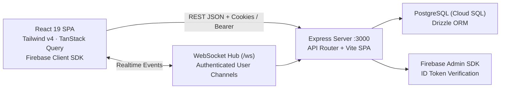

<div align="center">


<br />
<br />

# Stranger’s Wisdom

### *“Sometimes the right words come from someone you've never met.”*

An anonymous human connection platform designed for honest questions, lived perspectives, and quiet emotional safety—built without follower counts, public identities, or popularity feeds.

<p>
  
  
  
  
  
  
</p>

[Philosophy](#-philosophy) •
[Key Features](#-key-features) •
[Sanctuary Themes](#-sanctuary-themes) •
[Architecture](#-architecture) •
[Getting Started](#-getting-started) •
[Security & Safety](#-security--safety)

</div>

---

## 🌙 Philosophy

Most online spaces reward noise, status, and performance. **Stranger’s Wisdom** is built as a calm nocturnal sanctuary where people can speak openly about crossroads, doubt, grief, career uncertainty, college, friendship, and growth.

| What Stranger’s Wisdom Embraces | What We Intentionally Leave Out |
| :--- | :--- |
| Genuine lived perspective from strangers | Follower counts & social clout |
| Strict anonymity on every public thread | Public user profiles or identity handles |
| Calm, focused reading & writing surfaces | Infinite engagement-bait algorithms |
| Thoughtful reactions (*Helpful*, *Wise*, *Relatable*) | Public popularity leaderboards |
| Private drafts, saved wisdom & curated collections | Publicly exposed personal activity history |

---

## ✨ Key Features

### 💬 Meaningful Anonymous Q&A
- **Ask Anonymously**: Write distraction-free questions with category classification (*Life*, *Love*, *Friendship*, *Career*, *College*, *Growth*, *Decisions*), question intent (*I Need Perspective*, *What Would You Do?*, *Seeking Honest Advice*), custom topic tags, live preview, and private draft saving.
- **Thoughtful Answers**: Respond from personal experience using framed perspective tags (*I Experienced This*, *My Advice*, *Another Perspective*, *What I Learned*) with inline editing and deletion for your own contributions.
- **Always Accessible Participation**: Persistent **Ask a Question** floating action button on desktop/tablet and an elevated **Ask** entry point in the mobile bottom navigation bar.

### 🎙️ One Voice & Perspective Discovery
- **One Voice**: Request a single, deeply personal answer from one stranger—delivered privately without turning into a crowded public comment thread. Backed by atomic PostgreSQL transactions so only one stranger can claim and fulfill a One Voice request.
- **Give Me a Perspective**: Surface serendipitous, lived wisdom one reflection at a time with reaction support, bookmarking, and direct navigation to the originating thread.
- **Explore & Search**: Browse by category, filter unanswered questions, sort by recency or relevance, and search across titles, bodies, and tags with local search history.

### 🔖 Saved Wisdom, Collections & Link Sharing
- **Wisdom Collections**: Organize saved perspectives into personal themed collections (*Lantern*, *Horizon*, *Harbor*, *Sanctuary*) with custom cover artwork.
- **Context Menu & Direct Deep-Linking**: Every question and answer card features a `...` context menu with one-click **Copy Link**. Shared answer links (`/questions/:id#answer-:answerId`) scroll directly to and highlight the referenced insight.

### 🔔 Real-Time Presence & Notifications
- **WebSocket Updates (`/ws`)**: Instant delivery of answers, One Voice responses, and profile sync events for active accounts without aggressive polling.

### 🛡️ Privacy, Safety & Moderation
- **Automated Safety Screening**: Server-side detection for PII leaks (phone numbers, email addresses, SSNs), link spam, and distress signals with non-intrusive **Crisis Support Resources** surfaced automatically when needed.
- **Moderation Dashboard**: Dedicated moderation queue for reviewing user reports and auto-flagged content, hiding/restoring threads, and managing account status.
- **Full User Control**: Hide individual questions from your feed, restore hidden threads, export all personal data as JSON, or permanently delete your account.

---

## 🎨 Sanctuary Themes

Users can switch between **7 curated appearance themes** in **Settings**, persisted both locally (`localStorage`) and to their PostgreSQL profile:

| Theme | Mode | Palette & Atmosphere |
| :--- | :--- | :--- |
| **Midnight Sanctuary** *(default)* | Dark | Deep midnight navy (`#070B19`), indigo surfaces, electric cyan light |
| **Twilight Amber** | Dark | Warm obsidian plum (`#120B12`), soft charcoal surfaces, lantern gold glow |
| **Forest Stillness** | Dark | Deep pine slate (`#071412`), muted spruce cards, serene sage teal |
| **Velvet Dusk** | Dark | Cosmic indigo (`#0E0A1F`), twilight violet surfaces, lavender aura |
| **Warm Parchment** | Light | Soft sepia linen (`#FBF7F0`), warm ivory cards, gentle ink contrast |
| **Dawn Paper** | Light | Clean morning alabaster (`#F8FAFC`), crisp white surfaces, slate ink |
| **Follow System** | Auto | Dynamically adapts between Midnight Sanctuary and Dawn Paper |

<div align="center">
  <table>
    <tr>
      <td align="center"><br /><sub><b>Lantern</b></sub></td>
      <td align="center"><br /><sub><b>Horizon</b></sub></td>
      <td align="center"><br /><sub><b>Harbor</b></sub></td>
    </tr>
  </table>
</div>

---

## 🏛️ Architecture



### Tech Stack
- **Frontend**: React 19, TypeScript, Vite 8, Tailwind CSS v4, React Router v7, TanStack Query v5, Lucide Icons, Motion
- **Backend**: Node.js 22, Express 4, `ws` WebSockets, Zod validation, `tsx`
- **Database**: PostgreSQL (Cloud SQL) + Drizzle ORM (`drizzle-orm/node-postgres`)
- **Authentication**: Firebase Auth (Google Sign-In) + scrypt-hashed Email/Password & Anonymous guest sessions with HMAC-SHA256 signed cookies

---

## 📁 Project Structure

```text
.
├── server.ts                        # Express server, security headers, Vite dev middleware & /ws boot
├── index.html                       # App entry HTML & typography links
├── metadata.json                    # App metadata
├── vite.config.ts                   # Vite + Tailwind v4 + React configuration
├── walkthrough.md                   # Security review & verification walkthrough
└── src/
    ├── App.tsx                      # Client router & 24+ application routes
    ├── index.css                    # Tailwind v4 setup & 7-theme CSS variable palettes
    ├── assets/images/               # Sanctuary & wisdom collection artwork
    ├── components/
    │   ├── AnswerCard.tsx           # Answer display, inline editing, reactions & deep-link anchors
    │   ├── CardContextMenu.tsx      # Accessible '...' context menu with Copy Link
    │   ├── Layout.tsx               # Responsive shell, sidebar, mobile bottom nav & Ask FAB
    │   ├── QuestionCard.tsx         # Question discovery card with context menu
    │   ├── ReportModal.tsx          # Content reporting modal
    │   └── StateViews.tsx           # Loading, empty, error & crisis support states
    ├── contexts/
    │   ├── AuthContext.tsx          # Session lifecycle, theme sync & Firebase auth state
    │   └── RealtimeContext.tsx      # WebSocket listener & query cache invalidation
    ├── db/
    │   ├── drizzle.config.ts        # Drizzle Kit config
    │   ├── index.ts                 # PostgreSQL connection pool
    │   └── schema.ts                # Relational tables (profiles, questions, answers, drafts, collections, etc.)
    ├── lib/
    │   ├── api.ts                   # Typed API client with timeout & session expiry handling
    │   ├── clipboard.ts             # Iframe-safe clipboard helper & canonical share URL builders
    │   ├── firebase-admin.ts        # Server-side Firebase Admin initialization
    │   ├── firebase.ts              # Client-side Firebase SDK initialization
    │   ├── format.ts                # Date, status, reaction & category helpers
    │   └── themes.ts                # Theme definitions & document theme applier
    ├── pages/                       # Full page suite (Home, Explore, Search, Ask, Thread, My Wisdom, Saved, One Voice, Perspective, Profile, Settings, Moderation, Auth)
    └── server/
        ├── auth.ts                  # Scrypt password hashing, HMAC tokens & RBAC guards
        ├── constants.ts             # Shared categories, types & crisis hotline resources
        ├── moderation.ts            # Safety scoring, PII/spam filtering & distress checks
        ├── realtime.ts              # Authenticated WebSocket broadcast & per-user dispatch
        ├── routes.ts                # Complete REST API endpoints
        └── seed.ts                  # Idempotent initial sanctuary questions & wisdom seeding
```

---

## 🚀 Getting Started

### Prerequisites
- **Node.js 22+**
- **PostgreSQL** instance (e.g., Google Cloud SQL or local Postgres)
- **Firebase project** (`firebase-applet-config.json` configured for Web Auth)

### Environment Variables

Configure your environment variables (see `.env.example` for template defaults):

```bash
# Database connection
SQL_HOST="your-postgres-host"
SQL_USER="your-postgres-user"
SQL_PASSWORD="your-postgres-password"
SQL_DB_NAME="your-database-name"

# Application URL
APP_URL="http://localhost:3000"

# Optional Gemini / session configuration
GEMINI_API_KEY="your-gemini-api-key"
```

### Installation & Development

```bash
# 1. Install dependencies
npm install

# 2. Push database schema (if setting up a fresh PostgreSQL database)
npx drizzle-kit push --config=src/db/drizzle.config.ts

# 3. Start the full-stack development server on port 3000
npm run dev
```

### Production & Verification Scripts

```bash
npm run lint     # TypeScript type-checking (tsc --noEmit)
npm run build    # Build production frontend bundle to dist/
npm start        # Run production Express + WebSocket server (NODE_ENV=production)
```

---

## 🔐 Security & Privacy

- **Password & Session Hardening**: Random 16-byte salts with `crypto.scryptSync`, timing-safe hash comparisons, and HMAC-SHA256 `HttpOnly; Secure; SameSite=None; Partitioned` cookies paired with cross-origin mutation verification.
- **Zero Identity Leakage**: Public question, answer, and perspective endpoints strip internal author IDs, email addresses, and private aliases.
- **Transactional Concurrency Safety**: Atomic PostgreSQL transactions guard One Voice single-answer claims (`409 Conflict` on race) and advisory transaction locks serialize initial moderator assignment.
- **Single-Use Recovery Codes**: Password reset confirmation enforces rate limiting and rotates the account recovery code on every reset.

---

<div align="center">
  <sub>Built with quiet care for honest human connection.</sub>
</div>
